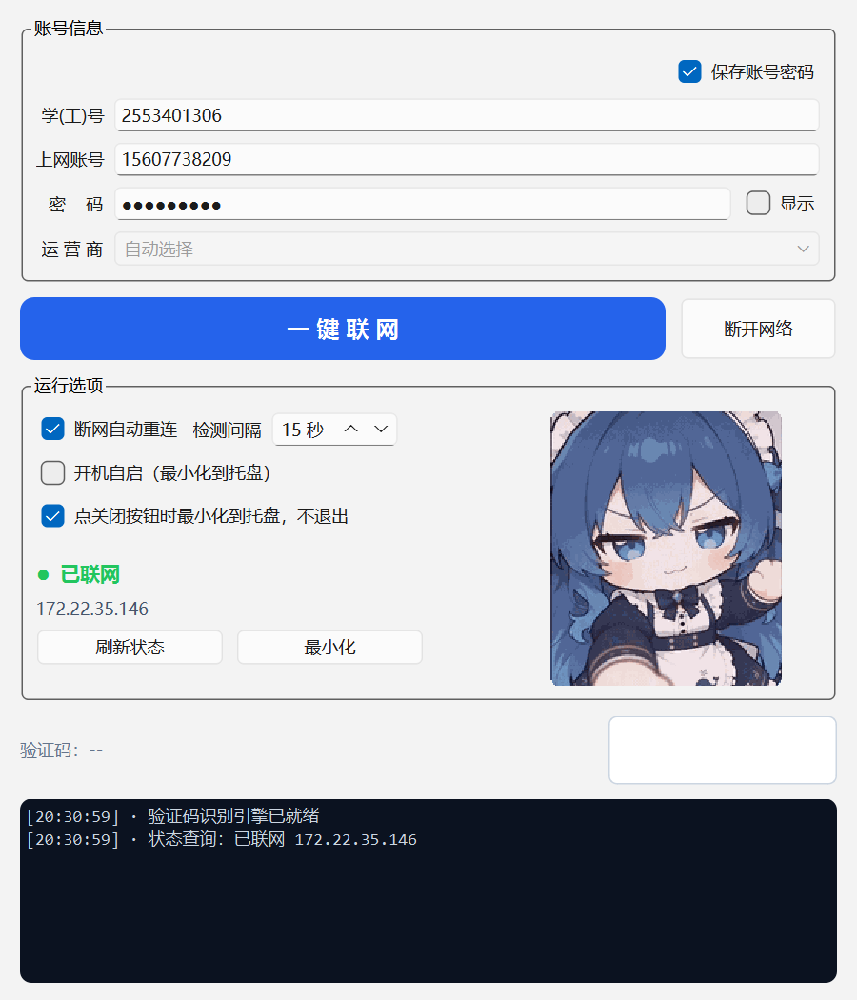

# GUIT 校园网一键联网

一个给校园网 Web 认证门户用的 Windows 桌面小工具。填好账号密码，点一下就连上；
验证码自动识别，断网自动重连，可以缩在托盘里常驻。

> 纯 HTTP 协议实现，**不驱动浏览器**：直接取验证码图片 → 离线 OCR → POST 表单。



## 功能

- **验证码离线识别**：内置 ddddocr，识别错了自动换一张重试（默认最多 6 次）
- **错误停手保护**：账号/密码这类硬错误立刻停止，不会反复重试把账号锁掉
- **断网自动重连**：后台按设定间隔轮询，掉线自动补登录
- **开机自启 + 托盘常驻**：启动即最小化到托盘，不占任务栏
- **一键断开**：需要切换账号时直接注销当前认证
- **界面状态**：显示当前 IP、在线状态、登录日志；右下角立绘随状态切换（未联网 / 已联网 / 联网失败）
- **网络测速入口**：一键打开测速页面

## 快速开始

### 直接下载

到 [Releases](../../releases) 页面下载，两种形态任选：

| 文件 | 说明 |
| --- | --- |
| `GUIT校园网一键联网.exe` | **单文件版**：双击即用。首次启动需要解压，慢几秒 |
| `GUIT校园网一键联网-文件夹版.zip` | **文件夹版**：解压后双击里面的 exe。启动快，兼容性最好 |

### 从源码运行

需要 Python 3.11。

```powershell
python -m venv .venv

# 依赖里有 PySide6，pip 解析会比较慢；用 uv 快很多
$env:UV_CACHE_DIR = ".\.uv-cache"
.venv\Scripts\uv.exe pip install --python .venv\Scripts\python.exe -r requirements.txt

.venv\Scripts\python.exe run.py
```

### 跑测试 / 打包

```powershell
.venv\Scripts\python.exe -m pytest      # 48 项离线测试，不碰网络
pwsh -File build.ps1                     # 打包（默认单文件版）
pwsh -File build.ps1 -Onedir             # 打包成文件夹版
pwsh -File build\ship.ps1                # 打包 + 验证 + 复制到桌面
```

打包完会跑一次产物级验证：直接执行 `exe --selftest`，确认依赖、OCR 和 GUI 都能加载。

## 工作原理

适配的是 ASP.NET WebForms 的认证门户（IIS + `.aspx`）。关键点：

- 每次 POST 都要带上**上一次 GET** 里拿到的 `__VIEWSTATE`、`__VIEWSTATEGENERATOR`、
  `__VIEWSTATEENCRYPTED`、`__EVENTVALIDATION`，外加同一会话的 Cookie
- 验证码是独立接口，**每次请求都重新生成**，所以必须"取图 → 识别 → 立刻提交"，不能缓存
- 服务端**先校验验证码、再校验密码长度**；密码有长度上限
- 失败和成功**都返回 HTTP 200**，只能靠页面文本判断

登录字段（可按自己学校的门户调整）：

```
__VIEWSTATE / __VIEWSTATEGENERATOR / __VIEWSTATEENCRYPTED / __EVENTVALIDATION
ctl00$MainContent$TextBoxISP   运营商（默认 自动选择）
SSOGUITID                      学(工)号（≤12 位）
SSOACC                         上网账号（≤12 位）
SSOPWD                         密码（≤16 位）
TextBoxCC                      验证码（4 位）
CheckBoxSaveMe / LoginBtn      记住我 / 登录
```

在线状态从注销页读取，页面里会给出「当前用户 IP」和「已联网 / 未联网」。

### 判断成败的一个坑

有的门户会把自己渲染的成功提示也塞进 `<p class="validation-summary-errors">` 里，
只看这个 class 会把成功当失败。这里的做法是**失败词优先**：
先匹配一批失败关键词（失败 / 错误 / 拒绝 / 无效 / 超时 / 未开通 / 欠费 / 并发 / 已在线 / …），
没有命中失败词、且出现成功词（成功 / 已联网 / 上线）才判定成功。

## 配置

程序同目录的 `config.json`（**明文保存密码**，注意别把这个文件发出去）：

```json
{
  "base_url": "http://10.6.6.6",
  "gui_id": "学工号",
  "account": "上网账号",
  "password": "密码",
  "isp": "自动选择",
  "auto_reconnect": true,
  "auto_connect_on_start": true,
  "poll_seconds": 15,
  "autostart": true,
  "save_credentials": true
}
```

- 取消勾选「保存账号密码」时，`gui_id` / `account` / `password` 三个 key 会从文件里**整个删掉**，
  下次启动回落到默认值，而不是留一个空密码
- `config.json`、`_boot.log`、`_selftest.log` 写完后会自动加上**隐藏属性**，不碍眼

## 目录结构

```
.
├─ run.py                打包入口（运行时先写 _boot.log，崩了也有据可查）
├─ build.ps1             一键打包
├─ src/
│   ├─ version.py        版本号（唯一来源，打包和界面都读它）
│   ├─ portal.py         门户协议层：取图 / 识别 / 登录 / 注销 / 状态
│   ├─ ocr.py            ddddocr 懒加载与结果清洗
│   ├─ service.py        登录编排（验证码重试）+ 断网自动重连线程
│   ├─ store.py          配置读写 + 文件隐藏
│   ├─ autostart.py      注册表开机自启
│   ├─ gui.py            PySide6 界面 + 托盘
│   └─ main.py           入口（含 --selftest）
├─ tools/
│   ├─ make_assets.py    从素材图生成图标 + 状态立绘
│   ├─ make_version.py   生成 exe 版本资源
│   ├─ verify_exe.py     产物级验证（跑 exe --selftest）
│   ├─ captcha_bench.py  识别率压测
│   ├─ cache_probe.py    验证码缓存探测
│   ├─ probe_login.py    真机链路验证（默认假账号）
│   ├─ screenshot_gui.py 界面截图
│   └─ make_montage.py   验证码样本拼图
├─ tests/test_portal.py  48 项离线测试
├─ build/ship.ps1        打包 + 验证 + 交付
└─ assets/               图标、状态立绘、验证码样本
```

## 打包形态怎么选

| | 文件夹版 `--onedir` | 单文件版 `--onefile` |
| --- | --- | --- |
| 体积 | 约 380 MB（600+ 个文件） | 约 188 MB |
| 启动 | 秒开 | 每次启动都要解压到 `%TEMP%`，慢几秒 |
| 开机自启 | 推荐 | 解压期间会让人以为没启动 |
| 对 `%TEMP%` 的要求 | 无 | 需要可写；权限受限时会静默退出 |

**结论**：要开机自启就用文件夹版；单文件版适合临时拷给别人用。

## 常见问题

**Q：验证码老认错？**
程序会自动换一张重试（默认 6 次），仍不行说明站点换了验证码类型或者识别库不适配，
可以用 `tools/captcha_bench.py` 批量测一下识别率。

**Q：开机自启没反应？**
先确认注册表 `HKCU\Software\Microsoft\Windows\CurrentVersion\Run` 里有对应的项，
再看任务管理器 → 启动应用里有没有被禁用。如果用的是单文件版，
启动时要在 `%TEMP%` 里解压，慢几秒是正常的。

**Q：单文件版双击没反应？**
看看 exe 旁边有没有生成 `_boot.log`。如果启动器报
`Could not create temporary directory!`，说明 `%TEMP%` 不可写，换文件夹版即可。

## 免责声明

本项目仅供**学习与个人使用**。使用前请确认符合你所在学校/单位的网络使用规定；
请只使用**自己的**账号凭据。作者不对任何滥用行为或由此产生的后果负责。

## License

MIT
